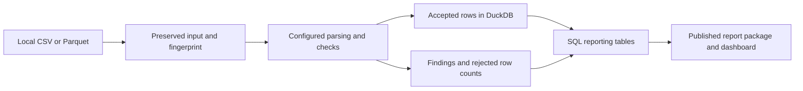

# Data Pipeline Toolkit

GitHub repository name `data-pipeline-toolkit`

Build a reusable Python and SQL pipeline that loads recurring data deliveries, checks their quality, and publishes reports. Use retail sales and returns for the first dashboard. Use a small synthetic inventory delivery to prove that a second dataset can use the same loader with a different configuration.

## Instructions for Codex

Work in a separate `data-pipeline-toolkit` repository. Treat this file as the implementation brief. Read any repository instructions and inspect the existing files before making changes. Build and verify the first release through the command line and dashboard. Record the commands run, the actual results, and any checks that could not be performed.

Use Python 3.12, DuckDB, SQL, Streamlit, and pytest. Keep dataset definitions in versioned JSON files and business queries in checked-in SQL. Use a `pyproject.toml` with an installable command, documented dependency versions, and a test extra. Support Windows PowerShell first. Use cross-platform paths and commands where practical. The demo should run locally with no account or paid service after dependencies are installed. Keep the existing Data Quality Monitor app independent. Its retail sample is an optional input and its previous findings provide a comparison point.

## First release

- Load local CSV and scalar Parquet files into a local DuckDB database.
- Validate and normalize data with dataset-specific column mappings, types, and rules.
- Preserve a fingerprinted copy of each input and record its delivery, source row, load outcome, and rule version.
- Append new deliveries safely, detect an already imported file, and allow retries after a failed load.
- Publish data quality results, retail summary tables, and a local dashboard. Show which deliveries and date range the dashboard covers.
- Provide an offline demo with two small synthetic retail deliveries and a synthetic inventory delivery. Offer instructions for the real UCI retail sample separately.

Forecasting, Prometheus alerts, scheduling, hosted storage, and a web upload interface are follow-on projects. Keep the first release small enough to demonstrate from a fresh checkout.

## How a delivery moves through the pipeline



### Dataset configuration

Use a common configuration format with a dataset ID, version, source-to-target column mappings, types, and rules. A dataset ID selects its own tables and reports. Validate config structure, supported types, identifiers, duplicate mappings, and rule references before processing data. Treat identifiers and values as data. Validate and quote identifiers and bind values in SQL. Keep arbitrary SQL out of dataset configuration.

Support text, integer, fixed-precision decimal, date, and timestamp. Specify CSV encoding and delimiter and use the configured date and timestamp formats. Read CSV identifiers as text so leading zeros survive. For Parquet, validate scalar types and explicitly reject unsupported nested schemas. Read data in batches. Preserve the original input and use stable, one-based input record numbers for lineage. Where a format includes an input record ID, preserve it separately.

| Check | Initial behavior |
| --- | --- |
| Unreadable file, malformed CSV structure, missing mapped column, or incompatible Parquet schema | Fail the delivery with a useful error and preserve previously loaded data. |
| Required value, type, or configured numeric bound fails | Reject the affected record and record each failed check. |
| Conditional warning, such as a missing customer ID on a UK record | Keep the record and record a warning. |

Treat blank and whitespace-only values as missing. Keep the original values in the preserved input. Use explicit error and warning codes. Track input, accepted, rejected, warned, and finding counts. A record with multiple findings counts once in each applicable record total. For a completed delivery, input equals accepted plus rejected. Warned records are accepted records with one or more warnings. Fail the delivery if it has zero accepted records. Include source file, record number, field, and check code in the findings export. Default shared reports to counts and rule names without source values or customer IDs.

### Storage and reruns

- Store a load history, per-dataset accepted rows, and findings in DuckDB. Each accepted row has a delivery ID and input record number. Give findings a link to the same delivery and record number, including for rejected records.
- Calculate SHA-256 for the archived source bytes and a deterministic hash for the normalized dataset configuration. Scan the preserved bytes so the fingerprint matches what was loaded. Store file size, source name, counts, timestamps, and status. Keep the source immutable throughout the run.
- Require an explicit delivery ID, such as `2025-01`. Within a dataset, a successful repeat of the same ID, input bytes, and configuration is a no-op. Reject changed bytes under a committed ID. If the same bytes arrive under a different ID with the same configuration, report the original delivery and skip the copy. Require a fresh work directory or an explicit rebuild procedure to process already loaded data with changed rules. Reject incompatible configuration changes against existing dataset tables and explain how to rebuild.
- Import new deliveries as new batches. Each ID should represent a distinct delivery period or partition. File hashes prevent exact file reimports. The first release does not merge overlapping exports or infer a global transaction key. Repeated invoice numbers can be valid line items. Document these boundaries and demonstrate with nonoverlapping demo files.
- Commit accepted rows, findings, and the successful delivery record in one DuckDB transaction. Roll back on a failed import and record a failure after rollback when the database is available. A failed attempt can be retried. Use a single writer and report lock conflicts clearly. Record the start, end, outcome, and elapsed time without printing raw records to routine logs.

## Retail example and dashboard

Map `InvoiceNo`, `StockCode`, `Description`, `Quantity`, `InvoiceDate`, `UnitPrice`, `CustomerID`, and `Country` to consistent snake_case names. Preserve `SourceWorkbookRow` when the prepared sample provides it. The workbook row identifies a row in that fixed source snapshot. Keep invoice, product, and customer IDs as text. Keep timestamps as recorded and document that the source supplies no timezone offset. Use exact decimals for prices and amounts in GBP. Check that prices are nonnegative, allow zero prices and signed quantities, and keep rows with a blank customer ID. Apply a warning when `Country` is `United Kingdom` and `CustomerID` is blank.

Compute `line_amount = quantity × unit_price`. Use positive quantities to count sales lines and negative quantities to count negative-quantity lines. Label the latter as a returns proxy. Record an invoice prefix of `C` or `c` as a cancellation flag, separately from quantity sign. Report gross sales value as the sum of positive line amounts, negative-line value as the absolute sum of negative line amounts, and net line value as the signed sum. If showing a value ratio, define it as negative-line value divided by gross sales value and display an unavailable state when gross sales is zero. Explain these definitions in the dashboard.

Publish daily totals by market and daily product totals by market. Build a read-only Streamlit dashboard that opens a completed report package. Include date and country filters, gross and net value, negative-line value, daily trends, and a ranked product table for negative-line value. Show import counts, findings by rule, and UK customer ID coverage with its denominator. Label data quality totals with their own delivery scope if they are independent of the dashboard filters. Read exported tables so an open dashboard does not hold a connection to the database during imports. Show the package generation time and included deliveries. Refresh the dashboard by opening the newly published package.

For the independent inventory example, use a synthetic CSV with `warehouse`, `sku`, `quantity_on_hand`, and `as_of_date`. Use the same loader with a second configuration, check that quantity is a nonnegative integer, and export load counts and findings. Retail SQL and fields should be unnecessary for this import.

## Dataset and expected observations

The real-data example uses the first 10,000 data records from the UCI Online Retail workbook. The previously prepared `online_retail_first_10000.csv` is available in the Data Quality Monitor workspace under `test-data/retail-pilot-source/`. Accept it as a user-supplied path. Document where to download the original workbook and how to prepare the same slice, including its header, source row, and ISO timestamp format. Keep downloaded data outside version control and include attribution in the README. Credit Daqing Chen (2015), *Online Retail*, UCI Machine Learning Repository, CC BY 4.0. [Dataset and license](https://archive.ics.uci.edu/dataset/352/online%2Bretail)

For the existing slice, expect 10,000 accepted records, 2,280 UK records with missing customer IDs, 130 negative quantities, and 46 zero prices. Its SHA-256 is `a121be4b6efa0c7d19c34c92856544ef7c9b1c795a2f7b24dec35223bec41e5b`. Use these checks for this exact slice. Label it as a convenience sample of the first 10,000 records and limit conclusions to the sample. Keep automated tests runnable with synthetic data when the sample is absent.

## Command line and repository layout

Use these examples as the interface contract. Have `report` publish a new completed directory per run and print its path. Write report tables, findings, a manifest with input fingerprints and counts, and an indication of completion. Stage the files before publishing the package so a failed export never appears complete. CSV outputs intended for spreadsheets should escape cells that could be interpreted as formulas.

```powershell
python -m pip install -e '.[test]'
dpt ingest --config configs/retail.json --source data/demo/retail-01.csv --delivery demo-01 --work-dir work
dpt ingest --config configs/retail.json --source data/demo/retail-02.csv --delivery demo-02 --work-dir work
dpt report --dataset retail --work-dir work --output reports
python -m streamlit run dashboard/app.py -- --report-dir "<completed package path>"
python -m pytest
```

```text
data-pipeline-toolkit/
  PROJECT.md
  README.md
  pyproject.toml
  configs/         # Retail and inventory definitions
  data/demo/       # Small synthetic deliveries
  src/dpt/         # Command line, readers, validation, and storage
  sql/             # Checked-in reporting queries
  dashboard/       # Streamlit app
  tests/           # Synthetic fixtures and workflow tests
```

Ignore local databases, downloaded data, snapshots, generated reports, and virtual environments. Make the README cover setup, exact demo commands, expected outputs, dataset attribution, metric definitions, and how to add a new dataset. Include a screenshot and an example showing how to diagnose a failed import and retry it.

## Build order and acceptance

1. **Import and validate.** Build the configuration, schema, readers, and ingest command. Run a synthetic CSV and equivalent Parquet fixture through the same rules. Check accepted and rejected totals, stable record locators, and original input hashes.
2. **Verify repeat delivery behavior.** Load both synthetic retail deliveries, rerun the first unchanged, and verify that accepted rows and report totals stay the same. Try a copy of the same file under a new delivery ID and a changed file under a committed ID. Verify outcomes match the rules above. Simulate a failed load, confirm no partial accepted rows are visible, and retry successfully.
3. **Publish reports and open the dashboard.** Verify sums and row counts against a hand-calculated fixture with sales, a negative quantity, a zero price, a missing UK customer ID, and a rejected row. Check filters, zero denominators, and the dashboard’s source and date scope. Run the Streamlit app through the documented command on Windows and open a generated report package.
4. **Prove reuse.** Run the inventory config through the same ingest and reporting commands without changing loader code. Run the real-data retail check when the exact slice is available. Record observed counts and sample scope. Verify the demo from a clean environment and add a GitHub Actions test job.

The first release is ready when a reviewer can follow the README from a fresh checkout, reproduce the demo and dashboard, rerun a delivery without changing totals, and load inventory through configuration. The repository should show a concrete business question, an explanation of the SQL and metrics, and evidence that a failed import can be retried safely.

References for implementation: [DuckDB transactions](https://duckdb.org/docs/stable/sql/statements/transactions) · [DuckDB Parquet support](https://duckdb.org/docs/stable/data/parquet/overview) · [Running Streamlit](https://docs.streamlit.io/develop/concepts/architecture/run-your-app)
