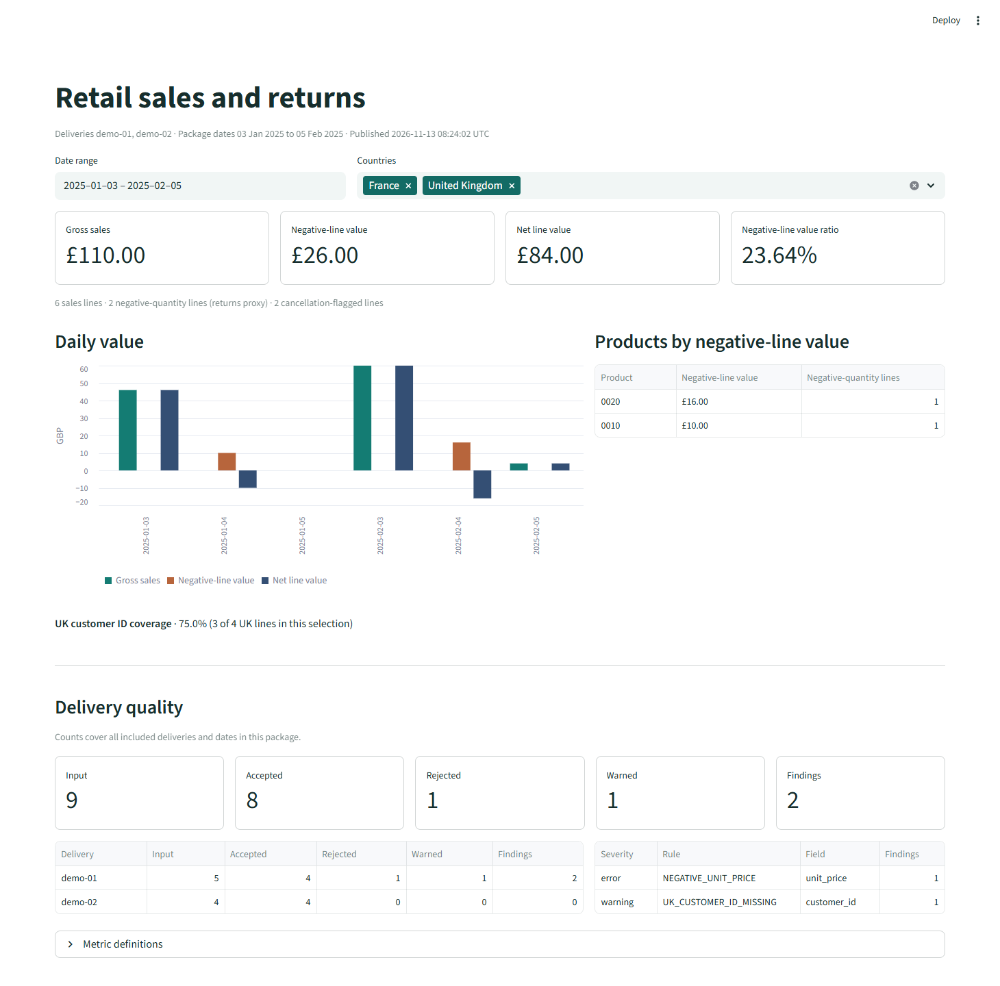

# Data Pipeline Toolkit

Validate recurring CSV and Parquet deliveries with versioned dataset rules, then publish DuckDB reports for a local Streamlit dashboard. The retail example answers how much negative-quantity activity reduced net line value and which products contributed most. The inventory example runs the same ingestion and quality reporting with a different JSON config.



## Run the demo on Windows

From the repository root, use Python 3.12. The package pins DuckDB, PyArrow, Streamlit, pandas, and filelock in [pyproject.toml](pyproject.toml). The test extra installs pytest. After installation, the demo runs offline.

```powershell
python -m venv .venv
. ./.venv/Scripts/Activate.ps1
python -m pip install -e '.[test]'
dpt ingest --config configs/retail.json --source data/demo/retail-01.csv --delivery demo-01 --work-dir work
dpt ingest --config configs/retail.json --source data/demo/retail-02.csv --delivery demo-02 --work-dir work
$retailReport = dpt report --dataset retail --work-dir work --output reports
$retailReport
python -m streamlit run dashboard/app.py -- --report-dir "$retailReport"
```

If PowerShell blocks activation, use `./.venv/Scripts/python.exe` and `./.venv/Scripts/dpt.exe` directly. On macOS and Linux, activate with `source .venv/bin/activate`.

The retail demo covers **3 January to 5 February 2025**. It produces 9 input records, 8 accepted, 1 rejected, 1 warned, and 2 findings. Expect £110.00 gross sales, £26.00 negative-line value, £84.00 net line value, and a 23.64% negative-line value ratio. There are 6 sales lines, 2 negative-quantity lines, 2 cancellation-flagged lines, and 1 zero-price line. UK customer ID coverage is 3 of 4 lines (75%). Product `0020` ranks first at £16.00 in negative-line value.

Open a second PowerShell session with the environment active, or stop Streamlit with Ctrl+C, then run:

```powershell
dpt ingest --config configs/retail.json --source data/demo/retail-01.csv --delivery demo-01 --work-dir work
dpt ingest --config configs/inventory.json --source data/demo/inventory-01.csv --delivery inventory-demo-01 --work-dir work
dpt report --dataset inventory --work-dir work --output reports
python -m pytest
```

The repeated retail import is skipped and the retail totals stay the same. Inventory reports 3 input records, 2 accepted, 1 rejected, and 1 `NEGATIVE_STOCK` finding.

## Reports and metric definitions

Each `dpt report` call prints a new completed directory. Use the directory containing `_SUCCESS` and `manifest.json`. The manifest describes package scope, generation time in UTC, delivery counts, input SHA-256 fingerprints, and config versions and fingerprints.

| File | Contents |
| --- | --- |
| `deliveries.csv` | Committed delivery counts, source names and fingerprints, and UTC timestamps |
| `attempts.csv` | Committed, skipped, and failed attempts, including error messages and original delivery IDs for skips |
| `findings.csv` | Delivery, source filename, one-based record number, field, rule code, severity, and config version |
| `findings_by_rule.csv` | Finding counts by severity, rule, and field |
| `retail_daily.csv` | Retail line counts and values by day and country |
| `retail_products.csv` | Retail line counts and values by day, country, and product |

An input record can produce multiple findings. For a committed delivery, input equals accepted plus rejected. Warned records are accepted records with at least one warning. Findings include warnings on rejected records when both checks apply. Reports omit raw finding values and customer IDs. CSV text that could be interpreted as a spreadsheet formula is prefixed with an apostrophe.

[The retail SQL](sql/) multiplies signed quantity by fixed-precision unit price to get line amount in GBP. Gross sales sums positive line amounts. Negative-line value is the absolute sum of negative line amounts. Net line value is the signed sum. The value ratio divides negative-line value by gross sales and is unavailable when gross is zero. Positive quantities count as sales lines, including zero-price lines. Negative quantities are a returns proxy. Invoice prefixes `C` and `c` flag cancellations independently of quantity.

The dashboard filters the daily and product reports by date and country. UK customer ID coverage uses accepted UK lines in the selection as its denominator. Delivery quality counts cover the entire package. Invoice timestamps have no source timezone offset. To refresh the dashboard after loading new deliveries, publish another package and restart Streamlit with its path. The dashboard reads the exports without connecting to DuckDB.

## Diagnose and retry a failed delivery

This example uses a separate work directory. The malformed second delivery has a two-field record under an eight-field header.

```powershell
dpt ingest --config configs/retail.json --source data/demo/retail-01.csv --delivery demo-01 --work-dir work-retry
Set-Content -LiteralPath work-retry/broken.csv -Value @(
    'InvoiceNo,StockCode,Description,Quantity,InvoiceDate,UnitPrice,CustomerID,Country'
    'bad,row'
) -Encoding utf8
dpt ingest --config configs/retail.json --source work-retry/broken.csv --delivery demo-02 --work-dir work-retry
$retryReport = dpt report --dataset retail --work-dir work-retry --output reports
Import-Csv (Join-Path $retryReport 'attempts.csv') |
    Format-Table delivery_id,status,accepted_rows,message
dpt ingest --config configs/retail.json --source data/demo/retail-02.csv --delivery demo-02 --work-dir work-retry
dpt report --dataset retail --work-dir work-retry --output reports
```

The bad import returns exit code 1 and identifies the malformed CSV line. The first report contains 4 accepted lines from `demo-01` and a failed attempt for `demo-02`. The retry adds 4 accepted lines, and the next report contains both deliveries.

Treat each delivery ID as a distinct period or partition. An exact input repeat with the same config is skipped, including when submitted under a new delivery ID. A committed ID rejects changed bytes. File hashing detects exact copies. Use nonoverlapping deliveries because the toolkit appends valid records and repeated invoice numbers can identify valid line items. To change a dataset's configuration, replay its original deliveries into a fresh work directory with the new config. The toolkit serializes database operations within a work directory. If it reports a busy directory, retry after the other command finishes.

The work directory holds the DuckDB database and the original bytes under `archive/<sha256>.source`. Keep it local. Record numbers exclude the CSV header and count a quoted multiline record once. For Parquet they follow the input row order. When available, `SourceWorkbookRow` is stored as a separate integer on the accepted retail row.

## Add a dataset

1. Copy [configs/inventory.json](configs/inventory.json). Choose a new lowercase dataset ID, give it a positive integer version, and configure the CSV encoding and one-character delimiter.
2. Map source headers to unique lowercase SQL column names using `text`, `integer`, `decimal`, `date`, or `timestamp`. Use `required` for nonblank values and `optional_source` for a mapping whose column may be absent. A decimal needs `precision` and `scale`. A date or timestamp needs a numeric, timezone-free Python format such as `%Y-%m-%d` or `%Y-%m-%dT%H:%M:%S`.
3. Add `numeric_bounds` rules with `min`, `max`, or both, and/or `warn_if_missing` rules with a `when` text field and exact `equals` match. Give each rule a unique uppercase code. Bounds use integers or decimal strings.
4. Ingest with that config and run `dpt report --dataset <dataset-id>`. Generic reports work for every dataset. The `retail` dataset ID uses the provided retail column layout for its business reports.

Parquet mappings use native scalar types. Use strings for identifiers, integer types for integer fields, integers or fixed-precision decimals for decimal fields, native dates for date fields, and timezone-free timestamps with microsecond precision or less for timestamp fields. Blank CSV cells, whitespace-only text, and Parquet nulls are treated as missing. A nested Parquet column or incompatible mapped type fails the delivery. Values that exceed configured precision or scale are rejected.

## Optional UCI retail slice

The prepared `online_retail_first_10000.csv` can be supplied directly from the Data Quality Monitor workspace under `test-data/retail-pilot-source/`. Use a separate work directory to keep sample and synthetic results distinct.

```powershell
$source = '../Data Quality Monitor/test-data/retail-pilot-source/online_retail_first_10000.csv'
Get-FileHash -Algorithm SHA256 -LiteralPath $source
dpt ingest --config configs/retail.json --source "$source" --delivery uci-first-10000 --work-dir work-uci
dpt report --dataset retail --work-dir work-uci --output reports-uci
```

To prepare the same slice, download and extract `Online Retail.xlsx` from UCI. Copy the first 10,000 data records from the first worksheet in their original order, starting at workbook row 2. Add a `SourceWorkbookRow` column containing workbook row numbers 2 through 10,001. Keep invoice, stock, and customer IDs as text, leave missing cells blank, and format `InvoiceDate` as `YYYY-MM-DDTHH:MM:SS` with no offset. Export as a UTF-8 comma-separated CSV with this header:

```csv
SourceWorkbookRow,InvoiceNo,StockCode,Description,Quantity,InvoiceDate,UnitPrice,CustomerID,Country
```

Keep the workbook and exported data in an ignored directory such as `downloads/`. CSV export tools can write different bytes for the same records. Apply the exact-slice acceptance checks when the SHA-256 is `a121be4b6efa0c7d19c34c92856544ef7c9b1c795a2f7b24dec35223bec41e5b`. The convenience sample covers **1 to 5 December 2010** and contains 10,000 accepted rows, 2,280 UK lines with missing customer IDs, 130 negative quantities, and 46 zero prices. These figures describe the first 10,000 records.

Daqing Chen (2015), *Online Retail*, UCI Machine Learning Repository, CC BY 4.0. [Dataset and license](https://archive.ics.uci.edu/dataset/352/online%2Bretail)

## Verification

See [the verification record](docs/verification.md) for the Windows commands run and their observed results. GitHub Actions is configured to run the synthetic suite on Windows and Ubuntu.
